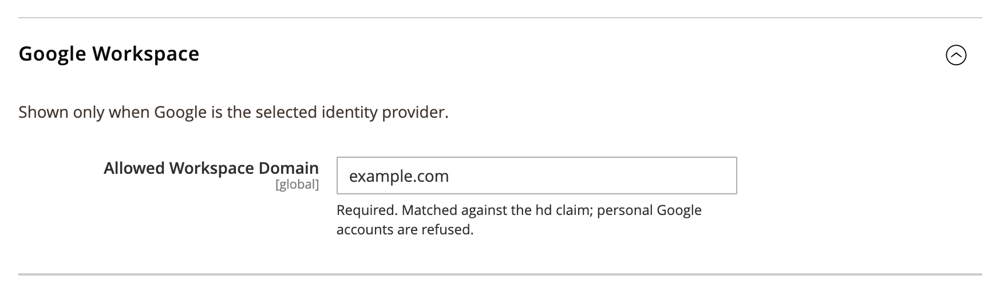

# DmLab_AdminSsoGoogle

> Google Workspace login for the Magento 2 admin panel.

[](https://github.com/dmlab-work/module-admin-sso-google/actions/workflows/ci.yml) [](https://codecov.io/gh/dmlab-work/module-admin-sso-google) [](https://packagist.org/packages/dmlab/module-admin-sso-google) [](https://packagist.org/packages/dmlab/module-admin-sso-google) [](https://packagist.org/packages/dmlab/module-admin-sso-google) [](LICENSE) 

Your team signs in to the Magento admin with their company Google account — a "Sign in with Google" button on the
admin login page. Only your company's Google Workspace domain gets in; personal Gmail accounts are refused.
Free, no user cap. Installs Admin SSO with it.



## Install

```bash
composer require dmlab/module-admin-sso-google  # also installs Admin SSO and the SSO engine
bin/magento module:enable DmLab_SsoCore DmLab_AdminSso DmLab_AdminSsoGoogle
bin/magento setup:upgrade
```

## Requirements

- Magento 2.4.7+ · PHP 8.2–8.5
- A Google Workspace account with admin access to create an OAuth client in Google Cloud Console
- An HTTPS admin URL for the redirect URI

## Create the Google OAuth client

In the [Google Cloud Console](https://console.cloud.google.com/) → **APIs & Services → Credentials**:

1. **Create credentials → OAuth client ID**, application type **Web application**.
2. **Authorized redirect URI**: `https://<admin-host>/<admin-path>/adminsso/sso/callback` (`<admin-path>` is the
   backend frontName, default `admin`). It must exactly match the admin URL used at runtime.
3. Create, then copy the **Client ID** and **Client secret**.

## Configuration

Admin → Stores → Configuration → **DMLab → Admin SSO**.

| Field | Path | Value |
|---|---|---|
| Enable Admin SSO | `general/enabled` | Yes |
| Identity Provider | `general/active_provider` | Google Workspace |
| Client ID / Client Secret | `general/client_id`, `general/client_secret` | from the Google OAuth client |
| Allowed Workspace Domain | `google/allowed_domain` | **required**; bare domain such as `example.com` (no scheme, `@` or path), validated and lowercased on save |

Paths are under `dmlab_admin_sso/`. The Google group is shown only when Google is selected. Default role and
enforce-SSO/break-glass are set in [admin-sso](https://github.com/dmlab-work/module-admin-sso).

## What it does

- Restricts sign-in to the allowed Workspace domain, checked against Google's hosted-domain claim on every login.
- Refuses personal Google accounts (they carry no Workspace domain).
- Requires a verified email (`email_verified=true`).
- Limits Google's account chooser to the allowed domain.
- Fails closed: while Google is active the domain cannot be saved empty, and if it is empty anyway every Google
  login is refused.
- Limitation: Google's sign-in token carries no group membership, so every Google admin gets the default role
  configured in Admin SSO (no group → role mapping).

Pairs with [Admin SSO](https://github.com/dmlab-work/module-admin-sso) · [Admin SSO Okta](https://github.com/dmlab-work/module-admin-sso-okta) · [Admin SCIM](https://github.com/dmlab-work/module-admin-scim)

## Architecture

This module is the Google provider plugin for `admin-sso`. `Model/GooglePreset.php` supplies the fixed discovery
URL (`https://accounts.google.com/.well-known/openid-configuration`), scopes `openid profile email`, a null groups
claim and the login-button label and logo; it also sends the allowed domain as the `hd` authorization param. That
param is only a hint the user can edit: `Plugin/EnforceHostedDomain.php`, a before-plugin on sso-core's
`IdentityFactory::create`, is the authority for the `hd` claim and `email_verified`. `etc/di.xml` registers the
preset into admin-sso's `PresetRegistry`. The OIDC protocol lives in `sso-core`; admin users, roles and the login
flow live in `admin-sso`.

## License

[OSL-3.0](LICENSE) © DMLab. Commercial licensing and support: <https://dmlab.work>.
